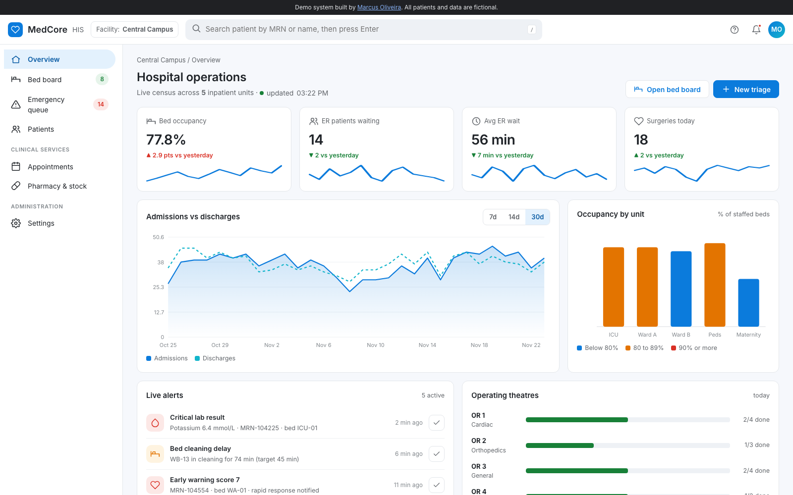

# MedCore HIS

Hospital information system console for daily operations: beds, emergency triage, inpatients, outpatient clinic and pharmacy stock.

**Live demo:** https://marcusolive.github.io/medcore-hospital/

> Portfolio project by [Marcus Oliveira](https://marcusolive.github.io). All patients, staff and clinical data are fictional and generated in the browser. Names are masked by default to show how a real system protects personal health information.



## What it shows

| Area | What you can do |
|---|---|
| Overview | KPIs with sparklines (bed occupancy, ER patients waiting, average ER wait, surgeries today), admissions vs discharges chart (7d/14d/30d), occupancy by unit, live alerts with acknowledge, operating theatre progress |
| Bed board | Color-coded bed tiles per unit (Occupied, Available, Cleaning, Reserved), unit filter and legend; discharge, assign from the ER queue, reserve or finish cleaning, with KPIs updating live |
| Emergency queue | Manchester-style triage (Red, Orange, Yellow, Green, Blue), waits over target highlighted, "Call next patient", new triage form, on-time rate per priority |
| Patients | Filterable table with MRN, masked name, age, unit, bed, attending physician and status; patient chart with vitals, 24 h heart rate chart, allergies and active medications |
| Appointments | Day schedule per doctor as a timeline, "now" marker, check-in, no-show and completion, booking from any free slot |
| Pharmacy & stock | Stock vs par level, days of cover, low and critical badges, reorder with purchase order, bulk reorder, dispensing by category and expiring lots |
| Settings | Units accepting admissions, privacy switches (name masking, audit log, break-the-glass, identifiable export), session timeout with auto-lock and an audit log |

## Stack

- HTML5, CSS3 and vanilla JavaScript (ES2020), no build step and no dependencies
- Shared UI kit (`assets/css/kit.css`, `assets/js/kit.js`): layout shell, SVG charts, data table, modal and toast
- Responsive down to mobile, keyboard shortcut `/` for patient search, `Esc` closes dialogs, ARIA labels on icon buttons, bed tiles and switches

## Project structure

```
index.html            page shell and views
assets/css/kit.css    shared design system (console layout, cards, tables, charts)
assets/css/app.css    product-specific styles (bed tiles, triage colors, schedule, stock bars)
assets/js/kit.js      UI kit: icons, charts, table, modal, toast, router
assets/js/data.js     fictional, deterministic sample data
assets/js/app.js      screens and interactions
docs/SPEC.md          functional specification and acceptance criteria
```

## Run locally

```bash
python3 -m http.server 8080
```

Then open http://localhost:8080. Any static server works.

## How it maps to a real system

In production this console would sit on top of:

- A clinical API (.NET or Java) exposing patients, encounters and beds as HL7 FHIR resources (Patient, Encounter, Location, Observation, MedicationRequest)
- An ADT event stream (admission, discharge, transfer) feeding the bed board and census in real time
- Integration with the laboratory system for critical results and with the pharmacy ERP for stock and purchase orders
- SSO with MFA, role-based access per unit, encryption at rest and an immutable audit trail, in line with LGPD and HIPAA requirements

## License

[MIT](LICENSE)
